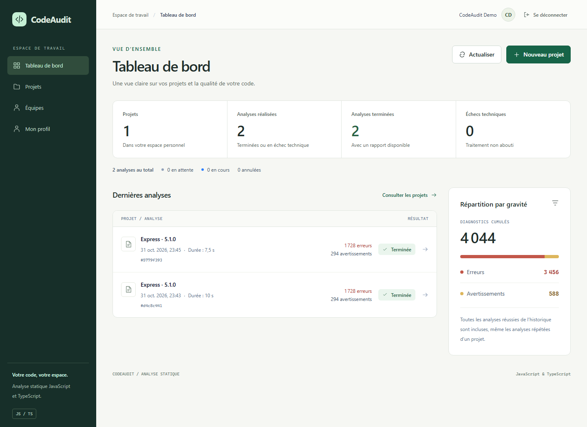
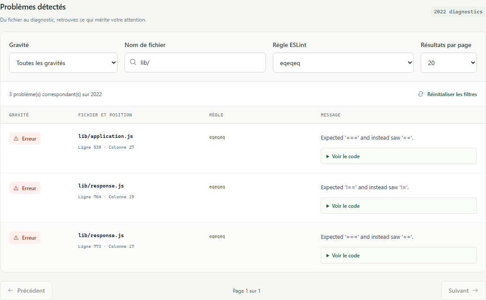
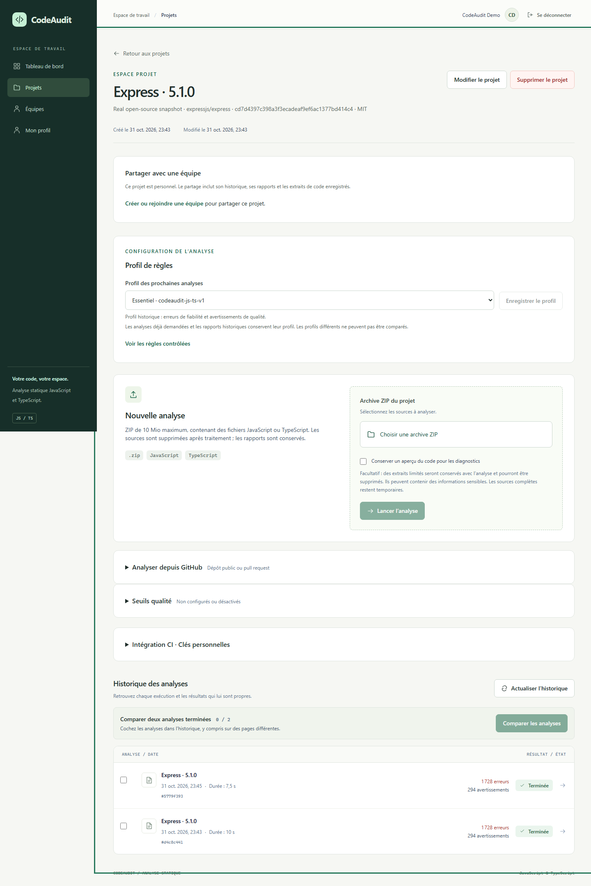
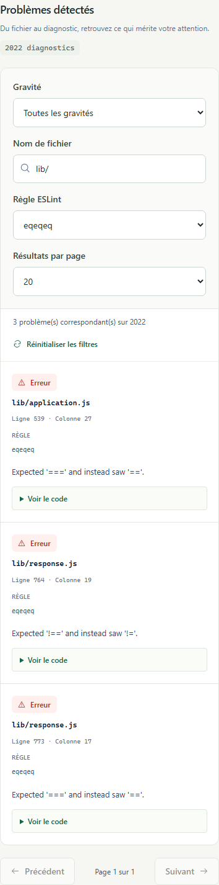
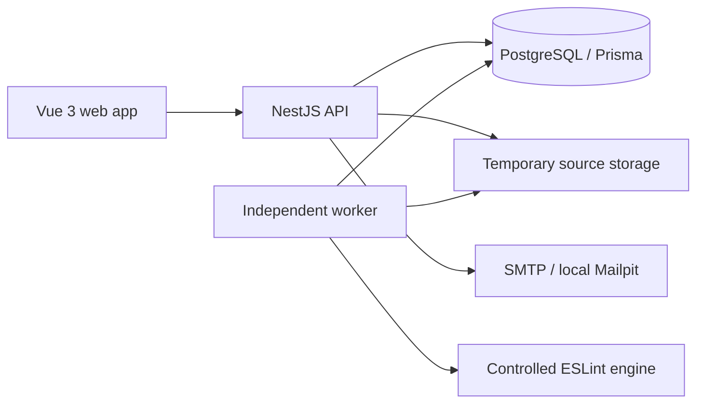

# CodeAudit

**Import a JavaScript or TypeScript project. Run a controlled audit. Track what changes.**

[](https://github.com/Alain-Tchougbo/CodeAudit/actions/workflows/ci.yml?query=branch%3Astaging)
[](LICENSE)

CodeAudit is a full-stack static analysis application built with Vue 3, NestJS,
PostgreSQL and ESLint. It turns ZIP archives or public GitHub snapshots into
persisted, searchable reports, with analysis history, comparisons and quality gates.
Imported projects are read as source text: their scripts and dependencies are never
installed or executed.

**[Try a real project](docs/demo.md)** · **[Development guide](docs/development.md)** ·
**[Architecture and specification](docs/specification.md)** · **[Building with Codex](#building-with-codex)**

The current integration branch is **`staging`**. This is a working local-demo MVP,
not a hosted service or a production security certification. The application UI
and detailed operating guides are currently in French.

## See it in action





These are actual application screenshots using a pinned upstream Express snapshot,
the real API, PostgreSQL and the worker. No response interception or invented
statistics are used. [Reproduce the demonstration and inspect the evidence](docs/demo.md).

<details>
<summary>Project history and mobile results</summary>





</details>

## What you can do

| Area | Implemented capabilities |
| --- | --- |
| Projects | Create, search, edit and delete personal projects; explicitly share them with a team. |
| Imports | Upload a ZIP or import a public GitHub repository, reference or pull request; preserve Git provenance. |
| Analysis | Audit `.js`, `.jsx`, `.ts`, `.tsx`, `.mjs`, `.cjs`, `.mts` and `.cts` with versioned Essential or Strict profiles. |
| Results | Inspect file, line, column, rule, severity and message; filter, search, paginate and optionally retain bounded code excerpts. |
| History | Reopen stored reports, compare new/persistent/resolved diagnostics and export versioned JSON. |
| Execution | Persistent PostgreSQL queue, atomic reservations, heartbeats, timeouts, cancellation and abandoned-job handling. |
| CI integration | Project-specific quality thresholds, expiring scoped API keys and a CLI with actionable exit codes. |
| Teams | Email invitations, administrator/member/reader roles and server-side access checks. |
| Accounts | Sessions, password recovery, email verification, profile/password changes, TOTP 2FA, recovery codes, session revocation, personal export, account deletion and security events. |
| External login | Explicit GitHub/GitLab account linking and login; requires provider credentials. |

An analysis that finds code errors can still be **`SUCCEEDED`**. **`FAILED`** means
the processing failed technically. A quality gate can fail independently of the
processing status. Comparing reports identifies absence or presence of diagnostics;
“resolved” does not prove a defect was fixed.

## Run locally

### Requirements

- Node.js **24.15+ within the 24.x release line**.
- pnpm **12.3.4**, matching `packageManager`.
- Docker Engine/Desktop with Docker Compose.
- Available ports: **5173** (web), **3000** (API), **5432** (PostgreSQL),
  **1026** (SMTP) and **8026** (Mailpit).

```sh
git clone --branch staging https://github.com/Alain-Tchougbo/CodeAudit.git
cd CodeAudit
pnpm install --frozen-lockfile
```

Create `.env` from `.env.example` **only if it does not already exist**:

```powershell
# PowerShell
if (!(Test-Path .env)) { Copy-Item .env.example .env }
```

```sh
# macOS / Linux
test -f .env || cp .env.example .env
```

Then run, from the repository root:

```sh
pnpm auth:init-key
pnpm db:up
pnpm db:migrate
pnpm mail:up
pnpm dev
```

Open **http://127.0.0.1:5173**, register your own account, then create a project.
Read local verification/recovery/invitation emails at **http://127.0.0.1:8026**.
Mailpit captures development mail; it does not deliver mail to the Internet.

`pnpm dev` starts the web app, API and worker. Compose runs PostgreSQL and,
with `pnpm mail:up`, Mailpit. The database uses a persistent Docker volume.
API and worker must use the same database and temporary storage root.
`pnpm db:down` stops the Compose services without deleting the database volume.

If 5432 is occupied, update **both** `POSTGRES_PORT` and the port in `DATABASE_URL`
in `.env`. Mailpit port overrides must match `SMTP_PORT`. See the
[configuration and troubleshooting guide](docs/development.md), including the
compiled-build workaround for a native Vite development-process crash observed
on the Windows demonstration workstation.

### Audit a real open-source project

```sh
pnpm demo:prepare
```

This downloads **Express 5.1.0**, pinned to commit
[`cd7d4397c398a3f3ecadeaf9ef6ac1377bd414c4`](https://github.com/expressjs/express/tree/cd7d4397c398a3f3ecadeaf9ef6ac1377bd414c4),
checks its SHA-256, and saves `.tmp/demo/express-5.1.0.zip` outside Git.
It does not install, extract or execute upstream code.

1. Create a project named `Express · 5.1.0`.
2. Keep the **Essentiel** profile and upload the prepared ZIP.
3. Start the analysis and follow its status.
4. Inspect and filter diagnostics, reopen the analysis from history, then export JSON.

[The French walkthrough](docs/demo.md) explains expected results, interpretation,
an optional GitHub import, and a checklist for your own projects. Express is an
independent MIT-licensed project, used here as a reproducible input, without any
claim of endorsement or of a security audit of Express.

## Architecture



| Workspace | Responsibility |
| --- | --- |
| `apps/web` | Vue 3, TypeScript, Vite, Vue Router, Tailwind CSS. |
| `apps/api` | NestJS endpoints, authentication, authorization and orchestration. |
| `apps/worker` | Queue polling, reservation ownership, processing and cleanup. |
| `packages/analyzer` | ESLint analysis, profiles, normalized diagnostics and statistics; independent of NestJS and Prisma. |
| `packages/analysis-jobs` | ZIP validation, GitHub import, source storage and queue operations. |
| `packages/database` | Prisma schema, PostgreSQL adapter and versioned migrations. |
| `packages/contracts` | Shared public types and report contracts. |
| `packages/config` | Shared TypeScript configuration. |

Completed reports are persisted independently of future analyses. Sources are
temporary; retained code excerpts are optional and explicitly removable.
Workers that lose their reservation cannot publish a report. Abandoned work is
finalized explicitly; the MVP does not silently rerun the same analysis.

## Verification

```sh
pnpm check                 # lint, type checks, builds, unit/frontend tests, Prisma validation
pnpm audit --prod          # current runtime dependency advisories
docker compose config --quiet
pnpm db:check              # connection and Prisma schema drift, read only
```

Integration and browser tests require a **separate, migrated PostgreSQL database
whose name ends in `_test`**, plus Mailpit. Never point them at data you want to
keep. [Set up the test environment](docs/development.md#tests-avec-postgresql-réel), then:

```sh
pnpm test:integration
pnpm test:e2e:install
pnpm test:e2e
pnpm exec playwright show-report
```

The latest completed account-security verification on **31 October 2026** passed
**286 unit/frontend tests**, **192 PostgreSQL integration tests**, and
**21 Chromium Playwright scenarios**. These are dated observations, not a coverage
percentage or a promise that counts never change. The
[CI run](https://github.com/Alain-Tchougbo/CodeAudit/actions/runs/41201993956)
and [experiment log](docs/experiment-log.md) document the evidence.

GitHub Actions performs a frozen install, runtime dependency audit, lint, type
checks, builds, migrations, drift checks, PostgreSQL integration tests and
Playwright. Browser failure traces are retained as CI artifacts for seven days.

## Security boundaries and current limitations

- **Controlled analysis:** imported ESLint configurations, plugins, inline rule
  overrides and dependencies are not loaded; autofix is disabled.
- **Bounded input:** ZIP ≤10 MiB, file ≤5 MiB, expanded data ≤50 MiB,
  ≤2,000 entries/nodes, extraction and analysis deadlines of 60 seconds each.
  Traversal, symlink, encrypted and duplicate-path entries are rejected.
- **Access control:** server-side sessions, HttpOnly cookies, CSRF protection,
  password hashing, quotas and ownership/team-role checks. No authentication
  tokens in localStorage. Sensitive account actions require reauthentication.
- **Configuration:** server secrets belong in the ignored `.env` or a deployment
  secret store. TOTP/OAuth need `SECURITY_ENCRYPTION_KEY`; external login also
  needs real provider applications. Live GitHub/GitLab login has not been
  verified with real credentials; automated provider exchanges use controlled transport.
- **Analysis scope:** no TypeScript semantic/type-program analysis, framework
  rules, dependency vulnerability scanning or secret scanning. Fixed globals may
  flag test-runner identifiers. A clean report does not establish security.
- **Deployment scope:** worker threads and V8 limits are not an OS sandbox or a
  global RSS/network limit. Public HTTPS deployment, load testing, backup
  restoration and an independent security audit remain outside the verified scope.

See [execution limits](docs/analyses.md), [engine behavior](packages/analyzer/README.md)
and [account security](docs/account-security.md) before exposing the service publicly.

## Building with Codex

CodeAudit has been developed iteratively with Codex, from the monorepo foundation
through analysis execution, frontend refinement, collaboration and account security.
The repository keeps the work reviewable through feature branches, pull requests,
migrations and automated checks.

The [experiment log](docs/experiment-log.md) records actions actually performed,
failures encountered, corrections and observed results. It includes concurrency
and transaction-conflict fixes, authentication regression testing and the local
Windows development-server limitation. [AGENTS.md](AGENTS.md) and the
[Git workflow](docs/git-workflow.md) describe the contribution rules.

This is an independent project by [Alain Tchougbo](https://github.com/Alain-Tchougbo).
It does not claim OpenAI endorsement or acceptance into any ambassador program.

## Documentation

| Guide | Contents |
| --- | --- |
| [Real-project demo · Français](docs/demo.md) | Pinned archive, walkthrough and measured results. |
| [Local development](docs/development.md) | Setup, environment, troubleshooting and test commands. |
| [Specification](docs/specification.md) | Scope, architecture and design decisions. |
| [Projects](docs/projects.md) / [Results](docs/consultation.md) | API behavior and UI contracts. |
| [Execution](docs/analyses.md) / [Cancellation](docs/cancellation.md) | Queue guarantees, limits and cleanup. |
| [Reports](docs/report-export.md) / [Rule profiles](docs/rule-profiles.md) | Stored report formats and controlled rules. |
| [GitHub imports](docs/git-import.md) / [CI integration](docs/ci.md) | Git provenance, quality gates, keys and CLI. |
| [Authentication](docs/authentication.md) / [Account security](docs/account-security.md) | Sessions, recovery, MFA and external login setup. |
| [Teams](docs/teams.md) | Invitations, sharing and role permissions. |
| [Experiment log](docs/experiment-log.md) | Development and verification evidence. |

## License

[MIT](LICENSE). Express belongs to its respective contributors and retains its
[upstream MIT license](https://github.com/expressjs/express/blob/cd7d4397c398a3f3ecadeaf9ef6ac1377bd414c4/LICENSE).
Upstream archives, local credentials and exported demonstration reports stay outside Git.
